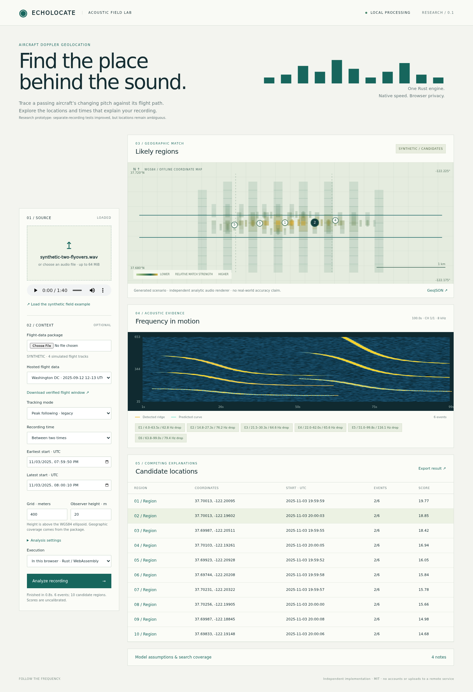

# Echolocate

[Open the web application](https://codyps.github.io/echolocate/) · [CI and deployment](https://github.com/codyps/echolocate/actions/workflows/ci.yml)

An independent Rust implementation of aircraft Doppler geolocation, with a local web application, a native CLI, and a static WebAssembly build. No `dopplerprint` code or dependency is used.

The application decodes audio, automatically proposes descending tonal events, and compares them with historical aircraft trajectories under a shared recording clock. It returns alternative candidate locations and an uncalibrated geographic match map. The same Rust code executes natively and in a browser worker. Coherent research mode adds a continuity-based ridge tracker and robust nonlinear shape matching; the legacy tracker remains available.

**This remains a research prototype with unreliable point locations.** The new coherent mode improves the original development result from 4.45 km to 326 m from the creator’s map reference. On five separate recordings evaluated after freezing the implementation and settings, shared-site fusion improves from 2.47 km to 1.43 km from a metadata-reconstructed receiver reference. The nearby tested cell ranks fourth, and single-clip results remain ambiguous. These are approximate reference comparisons, not surveyed GPS accuracy or calibrated confidence. See [diagnosis, separate-recording results and limitations](docs/ALGORITHM_IMPROVEMENT.md).



## Run locally

From this directory:

```bash
bash scripts/run-local.sh
```

Open **http://127.0.0.1:8765**, load the synthetic field example, and select **Analyze recording**. Browser execution uses the shipped Rust Wasm module. Choose **Local service · native Rust** to run through the native job service instead.

The project archive includes a prebuilt Linux x86-64 binary under `bin/` and a browser bundle under `web/`; the launch script uses them without rebuilding on that platform. The workspace also has Cargo's build outputs. Rebuilding requires Rust/Cargo and the `wasm32-unknown-unknown` target:

```bash
rustup target add wasm32-unknown-unknown
bash scripts/build.sh
```

No Node dependencies are needed to build or use the application. Modern browsers require serving the files over HTTP/HTTPS rather than opening `index.html` with `file://`.

The supplied Linux executable is statically linked with musl. To reproduce it on an x86-64 Linux Rust host, install the `x86_64-unknown-linux-musl` target and run `bash scripts/build-linux.sh`.

## Static deployment

Upload the contents of `dist/` to any static HTTP host. It contains HTML, CSS, JavaScript, Wasm, synthetic demonstration data, and a 5.6 MB licensed historical-flight catalog. There is no required remote application backend, account, map-tile service, or analytics. Browser mode reads selected files and performs computation on the device. Wasm runs in one worker; shared-memory headers are not required.

The hosted-data picker verifies SHA-256 and reconstructs lossless trajectory shards. Relative asset URLs support GitHub Pages project subdirectories. See [static data and deployment](docs/STATIC_DATA.md); `.github/workflows/ci.yml` tests and deploys to [GitHub Pages](https://codyps.github.io/echolocate/) after successful pushes to `main`. Pull requests run the same checks without deploying; manual dispatch is also available.

`dist/` deliberately contains no collected publisher-owned news audio. The geographic view is an offline, north-up coordinate map with paths and score cells; it does not include street or terrain tiles.

## Analyze your own audio

```bash
# Discovery without external data; always withholds absolute location.
target/release/echo-locate analyze recording.wav --output result.json

# Coherent research mode: automatic event discovery and finite geographic search.
target/release/echo-locate analyze recording.wav \
  --config data/coherent.config.json --package flights.package.json --output result.json

target/release/echo-locate validate-package flights.package.json
```

Supported decoders include WAV/PCM, FLAC, MP3, AAC/M4A, Ogg/Vorbis. Inputs are limited to 64 MiB; Opus and arbitrary video decoding are not supported. Extract lossless WAV excerpts with an external decoder when necessary, retaining the original timing provenance.

Configuration fields are documented in [docs/CONFIG.md](docs/CONFIG.md). Geographic and clock coverage, budgets, warnings, input SHA-256, and the effective configuration are included in results. Match scores are **not** probabilities. A completed heuristic search is not evidence of global uniqueness.

## Obtain historical flight data

The application needs a finite, configured historical-data corpus before audio can be matched to absolute locations. The acquisition helper discovers an adsb.lol daily release, checks the proposed download size, downloads/cache-checks its parts, streams trace files from the archive, and calls the Rust importer:

```bash
# Inspect availability and download size without downloading archive parts.
python scripts/fetch_adsb_day.py 2025-09-12 \
  --bounds=-77.12,38.8,-76.9,39.0 --output dc.package.json --dry-run

# This example's complete global daily archive is approximately 3.75 GB.
# Explicitly choose a sufficient local resource budget before acquisition.
python scripts/fetch_adsb_day.py 2025-09-12 \
  --bounds=-77.12,38.8,-76.9,39.0 --output dc.package.json \
  --max-download-mib 4000

# Or import already-downloaded readsb traces, plain or gzip-compressed.
target/release/echo-locate import-traces /path/to/traces \
  --bounds=-77.12,38.8,-76.9,39.0 --output dc.package.json
```

The 512 MiB default download budget rejects this large day before downloading it. The supplied validation acquired 491 historical traces using direct trace endpoints and checksum-verified HTTP ranges from archives, without downloading complete global days. See [source receipts and acquisition tools](corpus/news-tracks/README.md). Initial global archive ingestion can consume substantial disk space; extracted trace bytes have a separate explicit limit. Python handles acquisition/archive orchestration only; trajectory import, filtering, audio processing and inference are Rust.

The Rust importer uses geometric heights, rejects stale positions, and retains a 50 km aircraft margin outside the search bounds. It does not silently use pressure altitude as ellipsoidal height. This conservative policy can remove a large fraction of available points. Coverage is not assumed complete. Historical data is [adsb.lol ODbL](https://www.adsb.lol/docs/open-data/historical); preserve source attribution and applicable database terms when distributing packages.

Normalized CSV import is also supported:

```bash
target/release/echo-locate import-csv tracks.csv \
  --bounds=-123,37,-122,38 --source 'source URL and description' \
  --license 'source license' --output flights.package.json
```

CSV columns: `time_unix_s,lat,lon,height_ellipsoid_m`, optionally `flight_id,segment_index`. For `height_msl_m` or `height_egm96_msl_m`, supply an explicit `--geoid-undulation-m`; use a suitable model for the region. See [docs/DATA.md](docs/DATA.md).

## Separate-recording validation

[Five new recordings and four reserved AeroSonicDB clips](docs/ALGORITHM_IMPROVEMENT.md) were processed after the implementation, numerical settings and protocol were frozen. The earlier source is retained under `validation-baseline/`; exact results, all cases and failed/improved metrics are preserved. No evaluation signal was used for subsequent numerical tuning.

For several independently clocked recordings at the same stationary site, `echo-locate fuse-site clip1.json clip2.json --output shared-site.json` sums evidence on identical coarse grids. Every recording must contribute; scores remain uncalibrated. This is a native analysis option; the web UI currently analyzes one recording at a time.

## News and research validation corpus

- [Historical-flight validation and actual estimates](docs/HISTORICAL_VALIDATION.md), including the continuous original creator recording and 36 geographically selected aircraft.
- [Better ground-truth recordings](corpus/ground-truth/README.md): DLR measured local microphone positions, with explicit source-clock/trajectory caveats. AeroSonicDB coordinates are deliberately shifted and are excluded from exact-error claims.
- [Measured local-array protocols](docs/LOCAL_LOCATION_VALIDATION.md).

- [News/public-affairs corpus](corpus/README.md): four collected excerpts, approximately 199 seconds, with source evidence and hashes.
- [Independent research recordings](corpus/pathak/README.md): three Pathak WAV/KML/ridge/PDF cases acquired directly from Zenodo, CC BY 4.0.
- [Measured validation receipt](validation-runs/corpus/README.md).
- [Comparison against supplied frequency ridges](corpus/pathak/detector-comparison.md).

```bash
python corpus/fetch_audio.py --verify
python corpus/pathak/prepare.py --verify
python scripts/validate_corpus.py
python corpus/pathak/compare_detector.py
```

News publication time, the date of the reported event, recording-start time, event location, and microphone position are distinct fields. None is substituted for another. These inputs have been used for development and must not be described as a held-out accuracy benchmark.

## Verification

```bash
cargo test --workspace --locked
node --test tests/wasm-parity.mjs tests/data-client.mjs
python scripts/check_static_data.py dist
python tests/service.py
```

Optional real-browser checks:

```bash
npm install
npx playwright install chromium
node tests/browser.cjs
```

`ECHO_BASE_URL` selects a running preview; `ECHO_BROWSER_PATH` can select an installed Chromium. See [docs/VALIDATION.md](docs/VALIDATION.md) for measured checks and their limits.

## Native jobs

Native jobs persist their exact request, audio, status and result under `validation-runs/jobs/`. The UI can reconnect to a running job after refresh. Cancellation is checked between spectrogram batches and geographic cells; audio decoding/decimation is not immediately interruptible. Browser cancellation terminates the worker immediately.

If a native process stops, rerun its saved inputs:

```bash
target/release/echo-locate resume validation-runs/jobs/JOB_ID
```

This restarts computation from saved inputs; it does not checkpoint the numerical search lattice.

## Remaining research work

The current model assumes a stationary recorder, a constant emitted tone per event, and a supplied constant observer height. Uniform wind is configurable; still air is the default. Terrain/weather fields, recorder drift, frequency drift, robust global association, probabilistic audibility, calibrated confidence regions, and country-scale proposal-recall validation remain unfinished. A flight package is setup data, not something the browser can reconstruct from audio alone.

The news clips include edits, commentary and jet formations; a failed tonal detection can be appropriate. Detected ridges can also be spurious. Before making location claims, collect independently synchronized recordings with known microphone coordinates and representative competing aircraft. The next scientific milestone is blind regional validation with verified recording clocks and coordinates.

Code: MIT. Source recordings and historical databases retain their separately recorded licenses. [NOTICE.md](NOTICE.md) records attribution and the implementation boundary.
