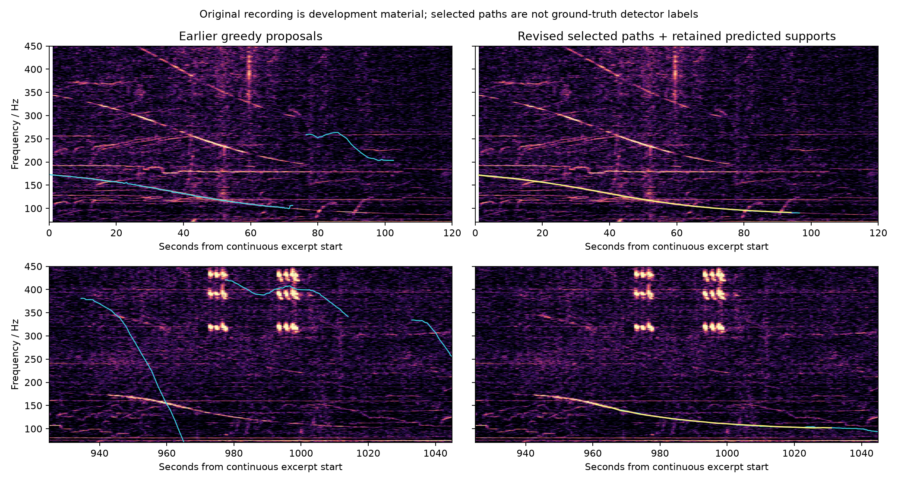
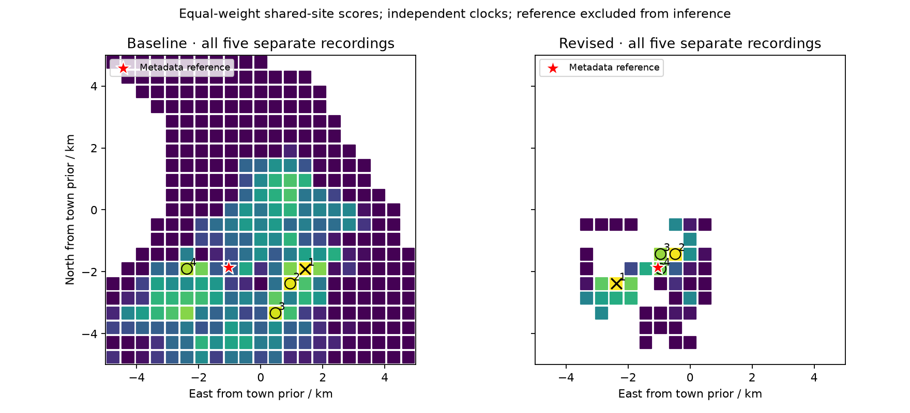

# Algorithm diagnosis and separate-recording validation

The revised method improves ranking on the original development recording and on five separate real recordings. It still does not provide reliable point locations. No parameters were retuned after the five-case evaluation.

## Original recording used for development

The prior high-recall 36-aircraft run placed its top candidate 4.45 km from the creator’s map reference. The frozen revised run places its top candidate **326 m** from that reference, at 40.874942, -73.523357. It automatically associates the two separated passages with PC-12 N22NY and King Air N93CQ within the same 36-aircraft package. Source coverage remains 36 of 133 discovered regional aircraft.

The two retained supports have raw frequency RMS 0.40 and 0.74 Hz. They use 100% and 75% of their automatic path proposals. The next spatial candidate is only 0.29 score units lower; neither the score nor this gap is calibrated confidence. The displayed creator coordinate is not surveyed microphone truth.

## Diagnosed causes and implemented changes

1. **Greedy peak following lost the weak second pass.** Second-order dynamic programming now rewards continuity and penalizes slope changes. It searches overlapping time blocks and overlapping frequency bands; otherwise strong high-frequency clutter consumes every path slot. Event selection uses fractional frequency change in coherent mode, avoiding an arbitrary preference for high harmonics.
2. **Clock proposals added the wrong delay.** For uniform straight-line motion in still air, the steepest *received* Doppler drop occurs at emission-clock CPA, not CPA plus acoustic travel time. The old proposal was biased by roughly 18 s on the first pass. A test checks the clock proposal and the independently derived analytic frequency curve. Retarded-time propagation remains in the actual frequency model.
3. **The old null was too easy to beat.** Smooth clutter could outscore a stationary tone. Robust matching now compares against a fitted linear chirp and enforces the configured RMS scale on retained points. Fixed contiguous support alternatives tolerate contaminated ends, with an explicit window-search penalty and reported coverage. No hand-marked event windows are supplied.
4. **Unmatched-event penalties rewarded weak associations.** Robust mode uses a zero-evidence clutter alternative and prevents overlapping supports from being counted as independent passages.
5. **Joint search was expensive and pruned the wrong stage.** Coherent mode first tests individual anchors, keeps up to 16 distinct clocks per cell, then jointly evaluates all events. Anchor fits are counted, cancellation is checked, and their separate hard budget is 16 times `max_hypotheses`. The search remains heuristic and can miss modes.

A narrow-band development improvement regressed when the analyzed band was widened. That regression motivated the frequency-band diversity change; it is not hidden as a successful broad-band result. Development attempts and final raw outputs are retained.

## Evaluation protocol frozen before the new signals were run

The implementation, exact inference configurations, data packages and evaluation script were SHA-256 frozen before testing. The earlier implementation is preserved under `validation-baseline/`. All five previously unused cases from the source constant-speed/height category were included: N4040_R12, N394FX_R20, N916KT_R22, N757AH_R41 and N413AK_R49. No case was removed because of its result. The four reserved AeroSonicDB files were also run; their event-proposal counts are not treated as detector accuracy.

The five Pathak recordings are different aircraft passages from the [published dataset](https://zenodo.org/records/23424278). Their source tracks and finite recording-time intervals are supplied; this is **assisted association**, not a blind search over complete competing air traffic. No published frequency curve is supplied to inference.

The common recorder reference was reconstructed without audio by intersecting three older cases’ published ground-track offsets with their KML tracks. Those constraints have residuals below 0.32 m, and the five new metadata offsets agree within 2.53 m. This is a strong internal metadata consistency check, **not a surveyed-GPS accuracy bound**. Source EGM96 heights are converted to relative local heights and embedded in an explicitly arbitrary local Cartesian frame; they are not relabeled ellipsoidal heights. The 10 km square prior is centered on a declared town coordinate, not the reconstructed receiver.

## Results on the five separate recordings

| Metric | Earlier method | Revised method |
|---|---:|---:|
| Single-clip median distance to reconstructed reference | 3295 m | 2792 m |
| Single-clip median ground-track-offset error | 1007 m | 435 m |
| All-five shared-site top-1 distance to reconstructed reference | 2474 m | 1432 m |
| Town-prior center baseline (no audio) | 2137 m | 2137 m |
| Rank of nearest tested site cell (101 m from reference) | 111 | 4 |

| Recording | Earlier point distance | Revised point distance | Earlier offset error | Revised offset error |
|---|---:|---:|---:|---:|
| N4040_R12 | 4007 m | 4007 m | 678 m | 678 m |
| N394FX_R20 | 6952 m | 1813 m | 1642 m | 1025 m |
| N916KT_R22 | 3077 m | 2792 m | 103 m | 435 m |
| N757AH_R41 | 2114 m | 3426 m | 1007 m | 318 m |
| N413AK_R49 | 3295 m | 717 m | 2978 m | 16 m |

All ten single-clip outputs remain `ambiguous`. A single nearly straight pass with an uncertain clock has along-track/time and mirror ambiguities. Cross-track offset is more identifiable than a unique map point. The revised point distance worsened for N757AH_R41, and N4040_R12 did not improve. The median individual point estimate is also worse than simply returning the declared town-prior center; only the shared-site fusion beats that baseline.

Shared-site fusion sums profiled scores from **all five** recordings on the same coarse grid, with a separate clock for each recording and equal weights. Missing recordings are never silently dropped. All-five fusion remains 1.43 km wrong at rank one; the nearby cell ranks fourth, not first. The nearest-cell result is diagnostic evidence of improved ranking, not a substituted success metric. This small test does not establish broad generalization or calibrated geographic accuracy.

The AeroSonicDB recordings have deliberately displaced public coordinates and no acquired historical tracks. Both engines found event proposals, and both withheld location without flight data. More proposals in revised mode do not prove better aircraft detection, so no recall/false-positive claim is made.

## Use and reproduce

The web interface exposes **Coherent paths · research** and retains the legacy tracker. The synthetic demo explicitly selects legacy mode so its demonstration contract remains reproducible. Native coherent analysis uses:

```bash
target/release/echo-locate analyze recording.wav --config data/coherent.config.json --package flights.package.json --output result.json

# Reproduce the old implementation from its preserved source.
cargo build --release --locked --manifest-path validation-baseline/Cargo.toml --target-dir target/baseline
python scripts/validate_independent.py

# Shared stationary site; same coarse grid and inference settings, separate clocks.
target/release/echo-locate fuse-site clip1.json clip2.json --output shared-site.json
```

The evaluation checks frozen source/protocol hashes. Rebuilding on another toolchain can change binary hashes; every run records the actual binary fingerprint. Acquisition helpers restore the five CC BY 4.0 source cases, verifying the publisher’s full ZIP MD5. See `data/independent-validation/freeze.json`, `pathak-protocol.json`, `docs/independent-validation.json` and retained raw results.

## Remaining causes of failure

Residual path contamination, incorrect dominant-harmonic selection, source-frequency drift, trajectory/atmosphere errors and profiled-score calibration remain unresolved. The five-case results also expose weak ranking between mirror/along-track alternatives. Further tuning must use development material; these nine recordings are now exposed evaluation material and cannot be reused as a fresh test set.





The site figure colors show score relative to each method’s own best, in method-specific uncalibrated units. Blank cells lack common surviving support from all five recordings; they are not assigned zero probability.
